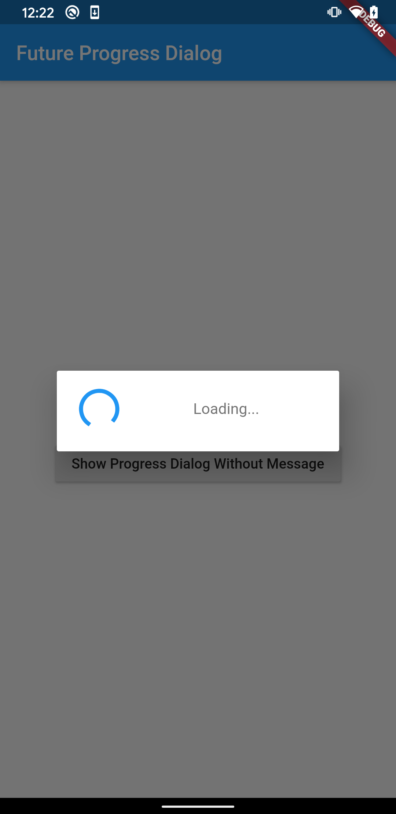
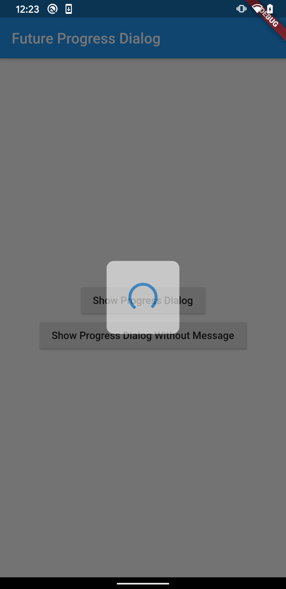

# future_progress_dialog

future_progress_dialog is a simple progress dialog library for async tasks.
FutureProgressDialog start when you call showDialog function, but dismiss automatically when future task is finished. 

## Supported Dart Versions
**Dart SDK version >= 2.12.0**

## Installation
Add the Package
```yaml
dependencies:
  future_progress_dialog: ^0.3.0
```

## How to use

Import the package in your dart file

```dart
import 'package:future_progress_dialog/future_progress_dialog.dart';
```

Call showDialog method with FutureProgressDialog with message.
```dart
    showDialog(
      context: context,
      builder: (context) =>
          FutureProgressDialog(getFuture(), message: Text('Loading...')),
    );
```



Or you can show it without message.
```dart
    await showDialog(
      context: context,
      builder: (context) =>
          FutureProgressDialog(getFuture()),
    );
```



## Cancel support

Pass a [cancelLabel] to render a cancel button below the progress indicator.
Pressing it invokes [onCancel] (if given) and closes the dialog with `null`,
so the caller can distinguish an explicit cancel from the normal result.

```dart
    final result = await showDialog(
      context: context,
      builder: (context) => FutureProgressDialog(
        getFuture(),
        message: Text('Loading...'),
        cancelLabel: 'Cancel',
        onCancel: () {
          // cancel the underlying async task
        },
      ),
    );
```

The dialog still closes automatically when the future finishes; if it is
closed first (via cancel), the pending completion is ignored.

